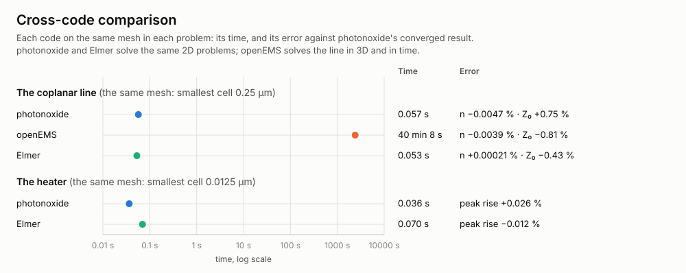

# Cross-code comparison

photonoxide's solvers checked against established codes on the same problems and the same
meshes: how far apart the results are, and how long each code takes. The codes are openEMS
(3D FDTD) for the RF line and Elmer (finite elements) for heat and electrostatics. This crate
runs them as external programs; it is local only, and CI never builds it.

## Results

<picture>
  <source media="(prefers-color-scheme: dark)" srcset="../docs/cross-code-chart-dark.svg">
  
</picture>

Each code on the same mesh, its error against photonoxide's converged result (the reference):

| Problem | Quantity | Reference | photonoxide | openEMS | Elmer |
|---|---|---:|---:|---:|---:|
| Coplanar line, 0.25 µm mesh | n | 2.217156 | 2.217052 (−0.0047 %) | 2.217069 (−0.0039 %) | 2.217161 (+0.00021 %) |
| | Z₀, Ω | 54.1476 | 54.5551 (+0.75 %) | 53.7113 (−0.81 %) | 53.9122 (−0.43 %) |
| | time | | 0.057 s | 40 min 8 s | 0.053 s |
| Heater over silicon, 0.0125 µm mesh | peak rise, K | 0.327422 | 0.327508 (+0.026 %) | — | 0.327384 (−0.012 %) |
| | time | | 0.036 s | — | 0.070 s |

- **Agreement:** refined to convergence, openEMS and Elmer meet photonoxide within 0.20 % and 0.047 % on Z₀, 0.0039 % and 0.00090 % on n, and Elmer within 0.0099 % on the heater's rise.
- **Speed:** photonoxide and Elmer solve the same 2D problems, so their times compare directly. Each is the code's own assembly and solve, the fastest of three runs. openEMS solves the line in 3D and in time (2.85 million cells for 339 345 steps), so its time is its own cost for that accuracy, not a like-for-like race.
- Every mesh and both codes' numbers on it: [docs/validation-openems.md](../docs/validation-openems.md) and [docs/validation-elmer.md](../docs/validation-elmer.md). The times are on an Intel Core Ultra 7 265K (20 threads), 64 GB, Windows 11.

## Problems

| Problem | What is compared | Codes |
|---|---|---|
| Ghione and Naldi's coplanar line: strips of zero thickness, a 20 µm signal, 10 µm gaps, on 20 µm of ε = 10, in a ±200 µm box | the line's index n and impedance Z₀ | photonoxide's quasi-TEM line, openEMS, Elmer (StatElecSolver) |
| A heater over silicon: 2 × 0.2 µm, 2 µm up in oxide on 10 µm of silicon held at 0, 1 W/m | the peak temperature rise | photonoxide's heat solver, Elmer (HeatSolver) |

## Running it

From the repository's root:

```sh
PHOTONOXIDE_OPENEMS=C:/openEMS just openems                                    # writes docs/validation-openems.md
PHOTONOXIDE_ELMER=C:/elmer/bin PHOTONOXIDE_ELMER_PATH=C:/msys64/ucrt64/bin just elmer   # writes docs/validation-elmer.md
just crosscode-chart                                                         # redraws the chart from results/
just crosscode                                                               # this crate's fmt, clippy and unit tests
```

- **Finding the programs:** `PHOTONOXIDE_OPENEMS` and `PHOTONOXIDE_ELMER` name each program or its folder; otherwise it is looked for on `PATH`. `PHOTONOXIDE_ELMER_PATH` names folders of Elmer's run-time libraries when they aren't on `PATH`. Without a program, its study prints `skipped:` and passes.
- **Settings:** `PHOTONOXIDE_MACHINE` names the computer in the reports, and `PHOTONOXIDE_OPENEMS_THREADS` sets openEMS's threads (8 by default).
- **Runs:** they are kept in `target/tmp/openems/` and `target/tmp/elmer/`, with each program's log beside them. A finished openEMS run of the same model is reused, so a rerun takes seconds; from scratch it takes about 1 h 13 min, and Elmer's study about 45 s.
- **Getting the programs and their licences:** [docs/cross-code.md](../docs/cross-code.md).

## Files

| File | What it does |
|---|---|
| `src/openems.rs` | finds openEMS, writes its XML input from its documented format, runs it with its progress, reads its probes |
| `src/elmer.rs` | finds ElmerSolver, writes its mesh files and solver input (SIF) from its documented formats, runs it, reads its output and its solvers' times |
| `src/cpw.rs` | the coplanar line, on the same mesh lines for photonoxide, openEMS and Elmer |
| `src/heater.rs` | the heater, for photonoxide and Elmer |
| `src/line.rs` | a line's wavenumber and impedance from voltages and currents at planes along it |
| `src/report.rs` | errors in percent, times and the computer's name, as the reports print them |
| `src/chart.rs` | the chart, from every study's points |
| `results/*.tsv` | each study's points (problem, code, mesh, value, error, time), committed |
| `tests/openems.rs`, `tests/elmer.rs` | the two studies; `tests/chart.rs` redraws the chart |

## Rules

- **External programs only:** openEMS (GPL-3.0) and Elmer (GPL-2.0 or later) are run as programs. Nothing of theirs is linked, built, shipped or read; their input is written from their documentation, and only their output is read back.
- **A new problem:** it gets both codes' setup on the same mesh lines and a study. The study reports each code's value and its error in percent against photonoxide's converged result, and its time where the codes solve the same problem.
